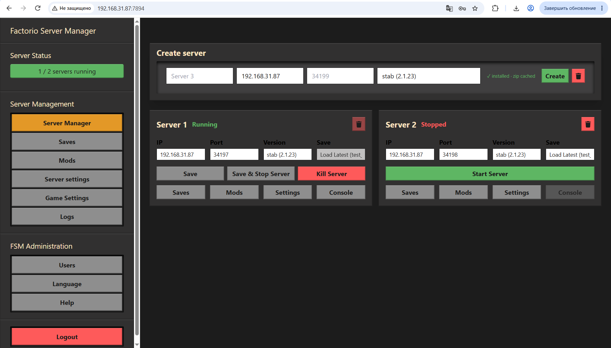
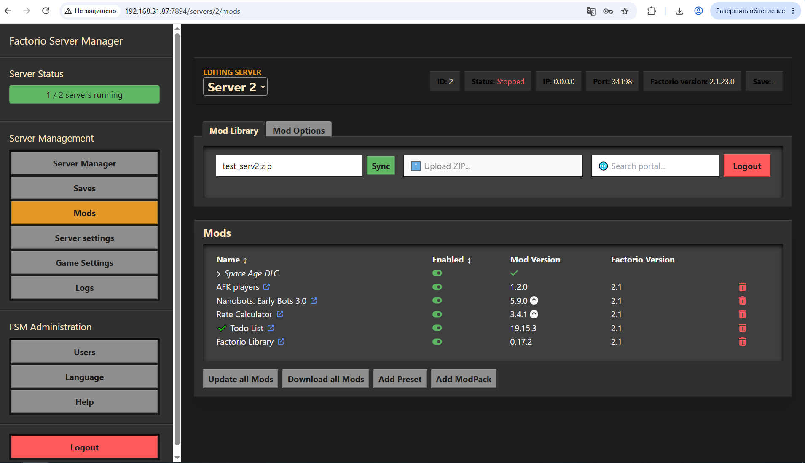
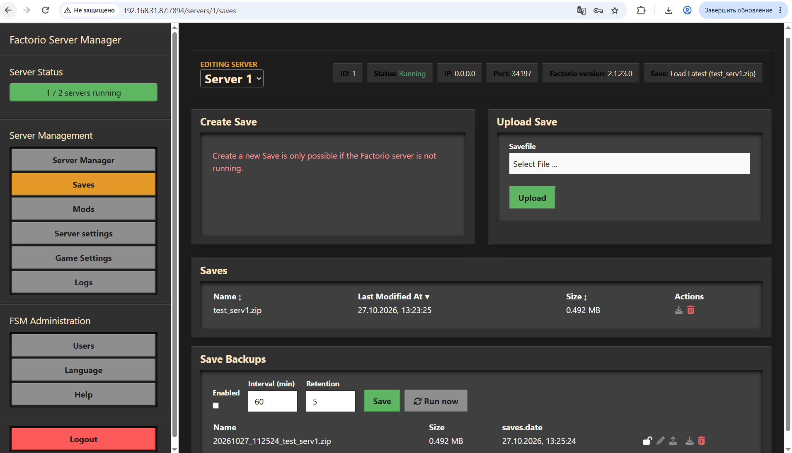
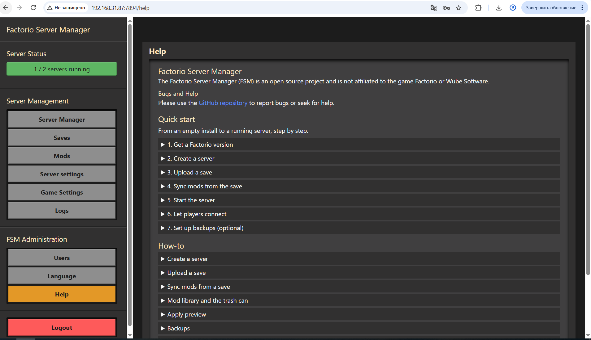
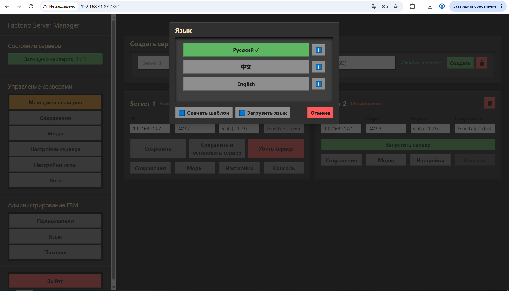
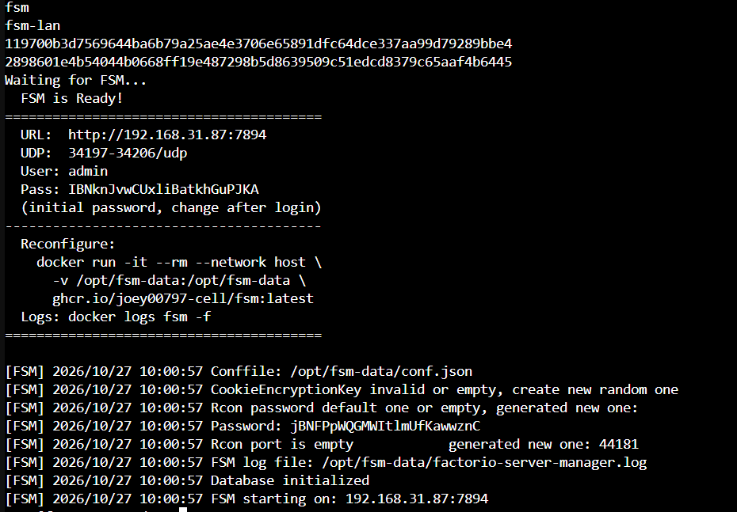

# Factorio Server Manager (fork)

Web UI for running several Factorio servers on one machine: Linux (Docker) or Windows (native exe, or Docker Desktop).

Fork of [OpenFactorioServerManager/factorio-server-manager](https://github.com/OpenFactorioServerManager/factorio-server-manager), reworked into a multi-server manager with a mod library, backups and a Windows build. History: [CHANGELOG.md](CHANGELOG.md) and [ROADMAP.md](ROADMAP.md). The original changelog is kept in [CHANGELOG-upstream.md](CHANGELOG-upstream.md).



## Features
* Multiple servers, each with its own saves, mods, config and logs
* Mod library with a per-server manifest, Apply preview and Sync from a save (Match save / Add from save)
* Scheduled save backups: retention, pin, rename, restore into any server
* Factorio versions are pinned per server; stab/exp channels change only when you ask
* Watchdog, RCON status, logs, inline server settings
* Help tab with a quick start and a danger zone (wipe or delete a server)
* Languages: EN, RU




| Help tab: quick start and how-to | Russian interface |
|---|---|
|  |  |

## Quick start: Linux (Docker)

```bash
docker run -it --rm --network host \
  -v /opt/fsm-data:/opt/fsm-data \
  ghcr.io/joey00797-cell/fsm:latest
```

`--network host` lets the wizard detect your IP and gateway. It asks about macvlan first (own LAN IP for the container, host IP + 1), then ports, and writes a start script:

```bash
bash /opt/fsm-data/fsm-start.sh
```

The URL and the initial admin password are printed on start. Change the password after the first login.



## Quick start: Windows without Docker

1. Download `fsm-windows-*.zip` from [Releases](https://github.com/joey00797-cell/factorio-server-manager/releases) and extract it to a folder you own.
2. Run `start.bat`. On the first launch it prepares Factorio and asks for the web port and display IP.
3. Open the printed URL, log in as `admin` with the printed password, create a server, upload a save.

Preparing Factorio needs the game: the Steam client, a client zip next to `start.bat`, or a folder path you type in. The script takes only `factorio.exe` from it and downloads the matching headless data. Stop all servers before preparing another version. Allow the server UDP port in Windows Firewall.

## Quick start: Windows with Docker Desktop

Run the wizard with your folder mounted (`-v C:\fsm-data:/opt/fsm-data`, without `--network host`), then `docker compose up -d` in that folder. macvlan does not work on Docker Desktop.

## Building from source
See [DEVELOPMENT.md](DEVELOPMENT.md).

## Contributing
1. Fork it, use `develop` as the base branch
2. Create a feature branch, commit, push
3. Add a line to CHANGELOG.md and ROADMAP.md
4. Open a pull request against `develop`

## Credits
* Original project: **Mitch Roote**, [knoxfighter](https://github.com/knoxfighter), [Jannaahs](https://github.com/jannaahs) and [all contributors](https://github.com/OpenFactorioServerManager/factorio-server-manager/graphs/contributors)
* Multi-server work: thanks to @TheCoolestPaul
* **mickael9** for reverse engineering the Factorio save format: https://forums.factorio.com/viewtopic.php?f=5&t=8568

Not affiliated with Factorio or Wube Software.

## License
MIT, see [LICENSE.md](LICENSE.md).
